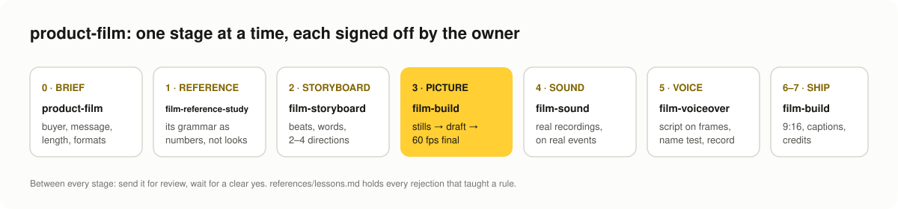
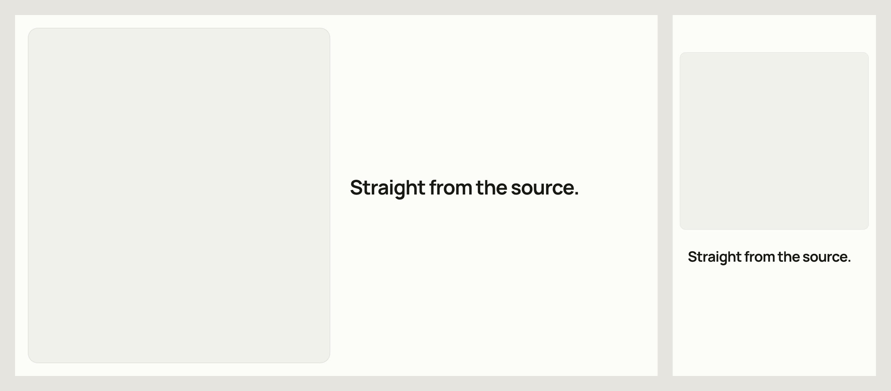
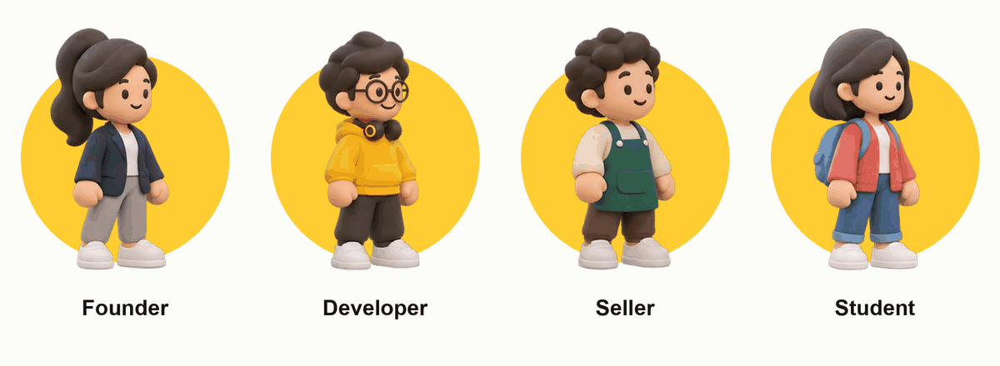
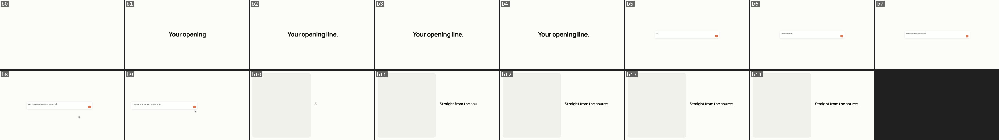

# Product film skills

Claude Code skills for making a product launch film in code, one reviewed stage at a time. The film is a web page
where `window.seek(t)` paints frame `t`. Headless Chrome renders it to 60 fps video with motion blur, in 16:9 and 9:16.

Each skill exists because a draft was rejected. The rules came from one launch film that went through more than 30 review rounds:
a reference recreation called "vibe-coded", sound effects called "AI slop", text that left before anyone could read
it, phone widgets at desktop size, a voiceover that only made sense with the picture. `product-film/references/lessons.md`
lists every one of those notes next to the rule it produced.



## The skills

| Skill | Stage | What you get |
|---|---|---|
| [`product-film`](product-film/SKILL.md) | Start here | Runs the stages in order and stops at each review. Has the question bank (concrete options for look, motion, pace, sound, voice) and the lessons file |
| [`film-reference-study`](film-reference-study/SKILL.md) | 1 · Reference | Takes a video you like apart frame by frame: cut times, holds, camera push rates, typing speed, where the beat drops. You borrow how it moves, never what it shows |
| [`film-storyboard`](film-storyboard/SKILL.md) | 2 · Storyboard | One page with a frame per beat, the words on screen, why each beat is there, and 2–4 directions when the story is open |
| [`film-build`](film-build/SKILL.md) | 3 · Picture, 6 · Formats | The project kit, the render pipeline, the realism rules (real logos, real OS chrome, real phone grids) and the QA checklist |
| [`film-sound`](film-sound/SKILL.md) | 4 · Sound | Real recorded sound effects (CC0 packs) placed only on real on-screen events, mixed to -14 LUFS and muxed without re-rendering |
| [`film-voiceover`](film-voiceover/SKILL.md) | 5 · Voice | Script written against the real frames, an eyes-closed test, a pronunciation test for the product name, recording per section, placement on the timeline |

## The build kit

`film-build/kit/init.sh` scaffolds a film project. The starter film has four example shots, each using a helper a
reviewer asked for: a line typed in, a prompt typed key by key with a caret and a cursor that dips on the click, and
words beside a picture that stack in 9:16, and a persona card with a drawn character.


*The kit's starter film as it renders out of the box, before you replace the example shots.*

The same file renders both formats. 9:16 gets its own framing, and a regression check proves the 16:9 output didn't change.



### Characters

If your film shows the kinds of people who use the product, give each one a drawn character that moves instead of
a text label. The kit comes with four, each a 12-frame loop where the character conjures something in their hands:



*The founder, developer, seller and student from a real launch film, in `film-build/kit/assets/characters/`.*

1. **Draw a sheet.** Ask an image model (ChatGPT works) for one character in 12 poses, in a 4×3 grid, on plain
   white or transparent. Use one chat per character so the style stays the same. Six frames looks stiff.
2. **Cut it into a strip.** `python3 tools/pack_grid.py sheet.png assets/characters/you-12.webp` finds the 12
   frames and puts every frame's feet on the same ground line. It keys out a white background from the edges, so white
   eyes and highlights stay, and it prints the cell size. Use `tools/cut_cast.py` for a one-row lineup of characters
   that stand still, for example a wall of personas.
3. **Play it.** In `film/film.js`:
   ```js
   S.toy = sprite(S.c, '../assets/characters/student-12.webp', 259, 360, 560, 'left:1210px;top:290px');  // in build
   putSprite(S.toy, t, 7.45, 9.7);   // in run: the 12 frames across 7.45–9.7 s, plus a slight breath
   ```
   The starter's fourth shot is a persona card built this way.

`node scripts/render.mjs --sheet` renders one frame per beat into a contact sheet. You review that, and stills,
before spending half an hour on a final render.



## Install

You need [Claude Code](https://claude.com/claude-code), Node 18+, ffmpeg and Python 3.

```bash
git clone https://github.com/aqeelshamz/product-film-skills.git
cd product-film-skills
for d in product-film film-*; do ln -s "$PWD/$d" ~/.claude/skills/$d; done
```

The symlinks keep the skills tied to the clone, so `git pull` updates them. Copy the folders instead if you'd rather
pin a version.

## Use

Ask Claude Code for a film in plain words. The `product-film` skill picks it up:

> Make a 45 second launch film for my app. Here's a video whose pacing I like: ~/Downloads/reference.mp4

Claude starts with the brief, then goes stage by stage. At each stage it sends you something to review (numbers and
frames from the reference, a storyboard page, stills, a draft, the cut with sound) and waits for a clear yes before
moving on. You can also call one stage directly, e.g. "storyboard this film" or "add sound effects to renders/16x9.mp4".

To start a project by hand:

```bash
sh ~/.claude/skills/film-build/kit/init.sh my-film
cd my-film
npm i && npx playwright install chromium
pip install numpy scipy soundfile pillow
```

Put your fonts in `assets/fonts/` (`display.woff2`, `ui.woff2`) and your brand colours in the `UI` tokens at the top
of `film/film.js`, then:

```bash
node scripts/render.mjs --at 1.2,3.4      # stills → review/stills/
node scripts/render.mjs --sheet           # one frame per beat → review/sheets/
node scripts/render.mjs --draft           # 30 fps, no blur → renders/draft_16x9.mp4
node scripts/render.mjs --verify          # every frame paints the same however you seek (12/12)
node scripts/render.mjs --all             # final: 60 fps, motion blur, every format in timeline.json
node scripts/render.mjs --mux --all       # put a new audio mix into the finished renders
```

Sound and voice use `scripts/sfx_samples.py`, `scripts/vo.py` and `scripts/mix.py`. The voiceover skill uses Fish Audio
for text to speech; any engine that gives you WAV files works with `vo.py`.

## License

[MIT](LICENSE). Fonts, sound packs, logos and wallpapers you add to a film keep their own licences; credit them in
`assets/CREDITS.md`.
